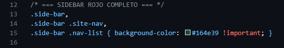
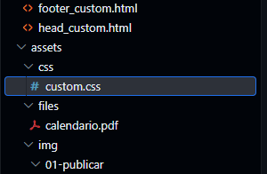
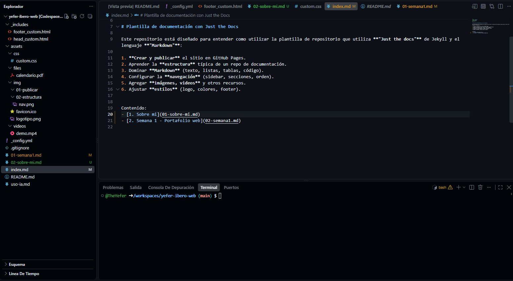
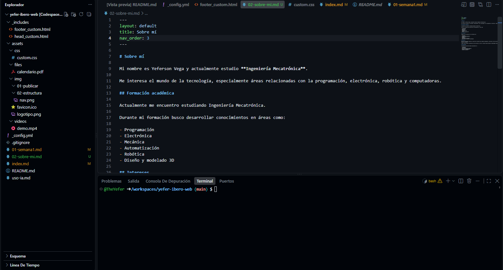
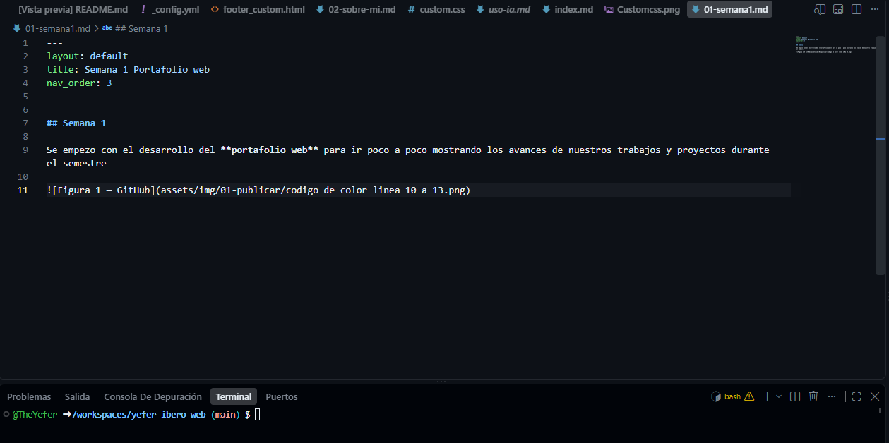
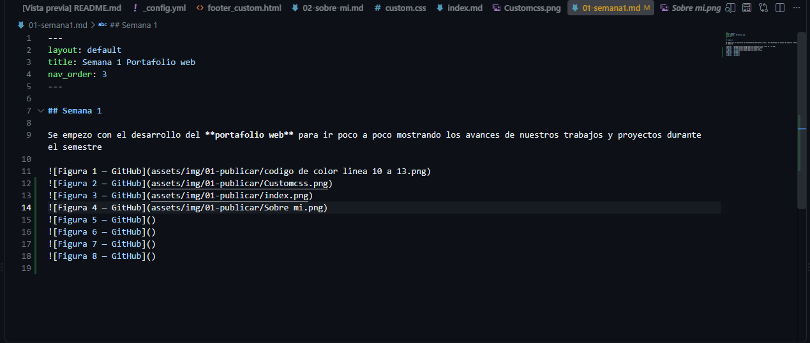
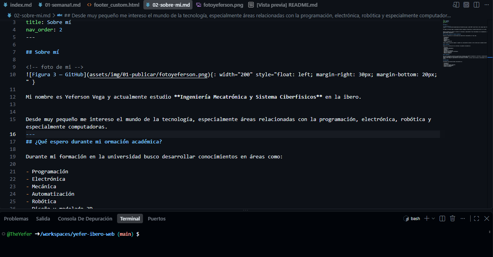

## Semana 1
Se empezo con el desarrollo del **portafolio web** para ir poco a poco mostrando los avances de nuestros trabajos y proyectos durante el semestre.

---
## Figura 1

---
Aquí cambie el color de la barra lateral de la página web

## Figura 2

---
Aquí es donde se ubica el archivo "custom.css" para moodificar y personalizar los colores y demás en la página web

---
## Figura 3

---
Aquí borre los demás apartados para agregar y/o modificar los apartados de la página

---
## Figura 4

---
Aquí cree el apartado: [**Sobre mí**](02-sobre-mi.md) donde puse un poco sobre mí 

---
## Figura 5

---
Aquí cree el apartado **semana 1** la cual es donde estás actualmente viendo esto.

---
## Figura 6

---
Aquí puse las imágenes que están viendo ahora mismo.

---

---
Aquí agregué mi foto.

---